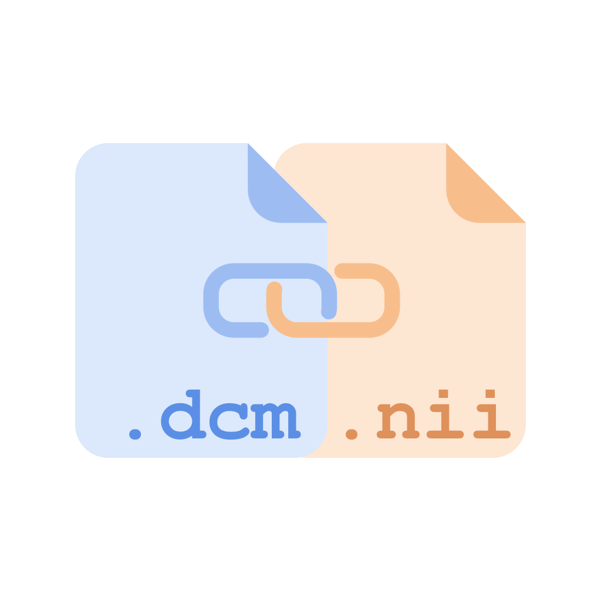

<p align="center"></p>

# DCMtether

Lossless DICOM ⇄ NIfTI round trips for MRI series, as a basis for derivatives (segmentations,
ADC/QSM maps) that are written back as properly referenced DICOM (SEG, Parametric Map, or
derived MR images for any PACS).

**Research use only — not for clinical or diagnostic use.** A converted dataset **identifies
patients** (file names are built from PatientName and StudyDate): never share it as is.

```
uv sync
uv run dcmtether run /path/to/dicom -o /path/to/dataset  # scan + convert (rerunnable; default output: the DICOM folder)
uv run dcmtether to-dcm DATASET/sub-…/….nii.gz rebuilt/  # back to identical DICOM
uv run dcmtether to-seg NIFTI labels.nii.gz seg-template.json seg.dcm
```

The same from Python ([API](docs/api.md)):

```python
import dcmtether as dt

result = dt.run("/path/to/dicom", "/path/to/dataset")
print(result.converted, result.failed)  # manifest ids
dt.to_dcm("dataset/sub-…/….nii.gz", "rebuilt/")
```

- [Usage](docs/usage.md): workflow and every command.
- [Python API](docs/api.md): the commands as functions.
- [Desktop app](docs/gui.md): a window for the same commands; portable Windows app.
- [Formats](docs/formats.md): dataset layout, file names, `*.tether.json`, sidecar, manifest, log.
- [Supported inputs](docs/supported-inputs.md): what converts, what does not, and why.
- Example metadata templates: [`docs/examples/`](docs/examples/); writing your own:
  [segmentation templates](docs/seg-templates.md).
- [Roadmap](docs/roadmap.md): ideas for later versions.
- [Changelog](CHANGELOG.md).

## Development

```
uv run ruff format --check . && uv run ruff check . && uv run pytest
```

Portable Windows app: `powershell -ExecutionPolicy Bypass -File scripts/build_windows.ps1`
(writes `dist/dcmtether-gui-<version>-win64.zip`).

The first test run downloads public test data and the DICOM standard into `.cache/`. Test data
coverage: `docs/dev/test-data.md`.

## License

dcmtether: lossless DICOM ⇄ NIfTI round trips for MRI series.
Copyright (C) 2026 Thomas Thiel

This program is free software: you can redistribute it and/or modify it under the terms of the
GNU General Public License as published by the Free Software Foundation, either version 3 of the
License, or (at your option) any later version.

This program is distributed in the hope that it will be useful, but WITHOUT ANY WARRANTY;
without even the implied warranty of MERCHANTABILITY or FITNESS FOR A PARTICULAR PURPOSE. See
the GNU General Public License for more details: [LICENSE](LICENSE).
